<p align="center">
  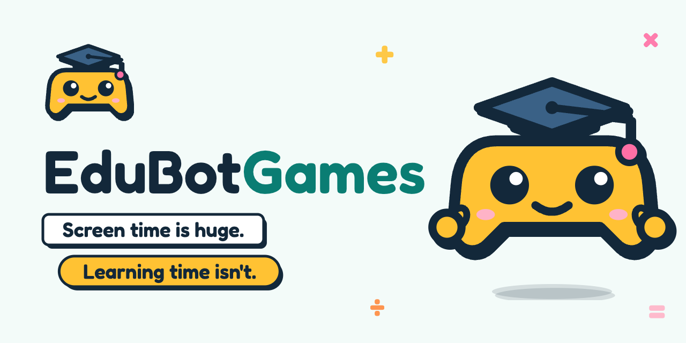
</p>

<h1 align="center">EduBotGames</h1>

<p align="center">
  <b>Parents pick the topic. Kids pick the game.</b>
</p>

<p align="center">
  A kid says what game they want to play. A crew of AI agents builds it around the lesson their
  parent chose, and Robo joins the kid's team with hints, never answers.
</p>

<p align="center">
  
  
  <br>
  
  
</p>

<p align="center">
  <b>AI that teaches, not cheats.</b>
</p>

<p align="center">
  <a href="#how-it-works">How it works</a> ·
  <a href="#meet-the-crew">Crew</a> ·
  <a href="#under-the-hood-agents-on-the-grok-api">Under the hood</a> ·
  <a href="#screens">Screens</a> ·
  <a href="#why-it-wins">Why it wins</a> ·
  <a href="#demo">Demo</a> ·
  <a href="#brand">Brand</a> ·
  <a href="#getting-started">Getting started</a>
</p>

## The problem

- Kids use AI to get answers, and the learning gets skipped.
- Learning apps hand every kid the same game, and kids get bored.
- Parents and teachers can't tell whether their kid actually improved.

EduBotGames splits the job. The parent decides what to learn: the topic, the kid's age, how many
questions. The kid decides how to play it, out loud, in their own theme. A crew of AI agents turns
both into one game. Robo plays it with them and nudges with hints when they get stuck. After the
game, Lens shows the parent the score before and after, and what to practise next.

## How it works

https://github.com/user-attachments/assets/8b84e99f-d853-4711-876d-85ff2a0ca4e3

Five agents hand JSON to each other in a loop, and the kid watches the handoffs light up while the
game builds.

1. 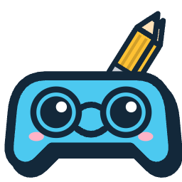 **The parent sets a goal.**
   "Multiplication up to 50", age 8, 10 questions. Prof, the Pedagogue, writes 10 tasks from easy to
   hard, each with one right answer and three likely mistakes.
2. 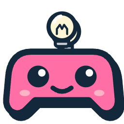 **The kid says the game.**
   "Dinosaurs in space." Grok Voice turns the speech into text. Spark, the Game Designer, offers 2 or
   3 game types in that theme, and the kid picks one.
3. 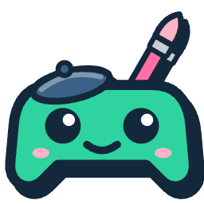 **The crew builds it.**
   Spark weaves the tasks into the game. Doodle, the Artist, paints the hero, the background and the
   items with Grok Imagine. The game engine, built by Cezary Dynak, takes the parent's inputs (topic,
   age, number of questions) and the kid's (voice idea, chosen game type) and generates a Phaser game.
4.  **Robo plays on the kid's team.**
   A wrong answer gets a short hint. A second wrong answer gets a stronger hint. Robo never says the
   answer, and cheers when the kid gets it.
5. 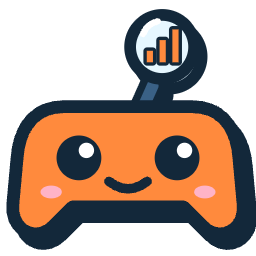 **Lens reports to the parent.**
   Accuracy before and after, per skill, the weakest skills and one next step. In the demo example,
   Maja goes from 40% to 75%.
6.  **The loop closes.**
   Lens hands the weak skills back to Prof, who writes the next 10 tasks around them.

## Meet the crew

Robo leads. The logo and the main character share one face: a game controller in a mortarboard,
with floating mitten hands and no body. Two agents work with the parent, three play with the kid.

| | Agent | Role | Talks to | Says |
|---|---|---|---|---|
|  | **Robo** | Teammate, the lead | The kid, inside the game. Sends results to Lens. | "Close! Try counting by 7s. Maja, your turn!" |
|  | **Prof** | Pedagogue | The parent. Hands tasks to Spark. | "Multiplication to 50 for age 8. I made 10 tasks, easy to hard." |
|  | **Spark** | Game Designer | The kid. Hands the game spec to Doodle. | "Dinosaurs in space! Catch star eggs, dodge comets or beat the space boss?" |
|  | **Doodle** | Artist | Grok Imagine. Hands the art to the game engine. | "Painting Rex, his rocket and four shiny space rocks..." |
|  | **Lens** | Analyst | The parent. Hands weak skills back to Prof. | "Maja went from 40% to 75%. Practise 7x and 8x next." |

Every agent has four motion states for the build timeline: idle, working, handoff and done
([`brandbook/assets/agents/`](brandbook/assets/agents/),
[`agents.json`](brandbook/assets/agents/agents.json)). In the game, Robo has four poses:

|  | 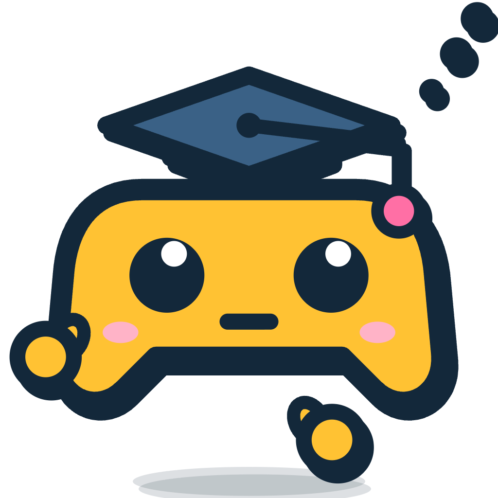 | 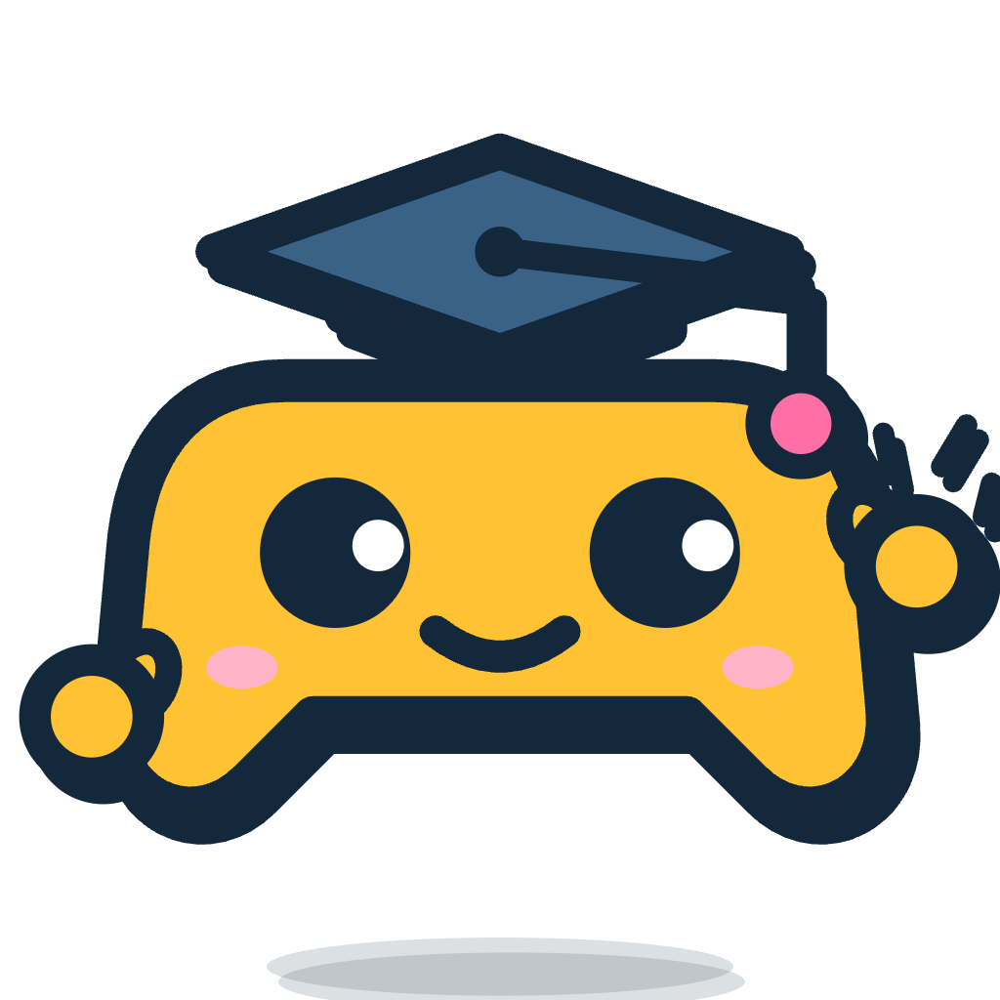 |  |
|:---:|:---:|:---:|:---:|
| Idle | Thinking | Hint | Cheering a right answer |

## Under the hood: agents on the Grok API

Every agent is its own server-side module with its own prompt, its own JSON schema and its own
guardrail. A plain-code orchestrator chains them and streams each step to the kid's screen, so the
handoffs light up live.

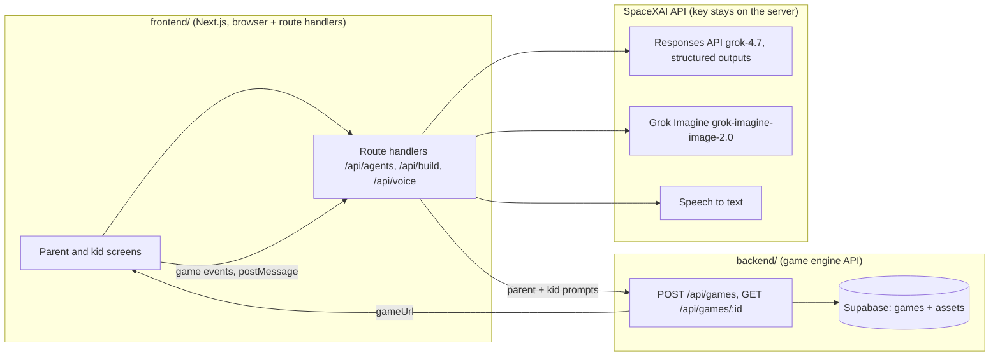

| Agent | Route | Grok API | In -> out | Guardrail |
|---|---|---|---|---|
| Prof, the parent's agent | `POST /api/agents/prof` | Responses API, `grok-4.7`, JSON schema | Parent's free text, age, count -> one clear goal + 10 tasks | One right answer and three likely mistakes per task, easy to hard |
| Spark, the kid's agent | `POST /api/agents/spark` | Responses API, JSON schema | Kid's idea + parent's topic -> 2-3 game types | Each option is a different template whose mechanic practises the topic |
| Doodle | `POST /api/agents/doodle/options` | Grok Imagine | Kid's theme + game type -> one scene per option | Brand style, no text, cached by theme and type |
| Robo | `POST /api/agents/robo` | Responses API, JSON schema | Task + wrong answers + players -> hint, cheer or turn | Never says the answer |
| Lens | `POST /api/agents/lens` | Responses API | Game events -> report | Accuracy is computed in code; the model only writes the summary and the next step |
| Voice | `POST /api/voice/transcribe` | Speech to text | Kid's recording -> text | Text field as a fallback |
| Orchestrator | `POST /api/build` (Server-Sent Events) | none, plain code | Plan + chosen game -> agent events, preview, game | Validates every body with zod before any call |

Why this is multi-agent and not one big prompt:

- Two agents serve two people. Prof answers the parent's question, "what does my child need to
  learn?". Spark answers the kid's, "how can this be a game?".
- Handoffs are typed. Prof's tasks go to Spark, Spark's choice goes to Doodle and to the engine,
  game events go to Lens, and Lens's weak skills go back to Prof for the next round.
- The engine gets plain-text prompts built from the agents' output, including the visual style, so
  the generated game matches the app ([docs/engine-prompts.md](docs/engine-prompts.md)).

### Measured on the live API (5 Nov 2026)

Kid's idea "unicorns on the beach", parent's text "she cannot read the clock yet", age 7.

| Step | Result | Time | Cost |
|---|---|---|---|
| Prof | Goal "Read the time on a clock", 10 tasks from full hours to quarter hours | 17.7 s | $0.0129 |
| Spark | Unicorn Clock Shells (collect), Unicorn Time Dash (runner), Beach Clock Battle (quiz battle) | 5.2 s | $0.0055 |
| Doodle | 3 scenes drawn in parallel, unicorns on a beach in the brand palette | 19.2 s | $0.12 |
| Doodle, repeat | Same scenes from the cache | 8 ms | $0 |
| Build | Preview reused from the cache, engine call done | 1.29 s | $0 |
| Speech to text | "I want a game with dinosaurs in space." | 0.68 s | about $0.0001 |
| Robo | "Super close! Start from 7 x 7, then add one more group of 7." | 5.7 s | under $0.01 |

All test rounds so far cost about $0.31 of the $60 budget.

### Status

- Live: Prof, Spark, Doodle, Robo, speech to text, the build stream, and the Phaser engine.
- One Next.js app in `backend/` serves the screens and `POST /api/games`. `frontend/` is the source
  for the screens. `npm run sync:web` copies them in before dev and build.
- Game events: the Phaser page posts answers to the app with `postMessage`
  ([docs/game-events.md](docs/game-events.md)). Lens still needs a live `XAI_API_KEY` for the written
  summary. Accuracy is computed in code.
- Login is a demo account ([tests/test-accounts.md](tests/test-accounts.md)).

Code: agents in [`frontend/lib/agents/`](frontend/lib/agents), the xAI client in
[`frontend/lib/xai/`](frontend/lib/xai), routes in [`frontend/app/api/`](frontend/app/api), the
engine API in [`backend/`](backend) with its contract in
[`packages/api-contract`](packages/api-contract).

## Screens

These are the web app screens, designed at desktop width (1440 px). Parent screens use Figtree; kid
screens use Fredoka at 18 px and up.

| | |
|:---:|:---:|
| 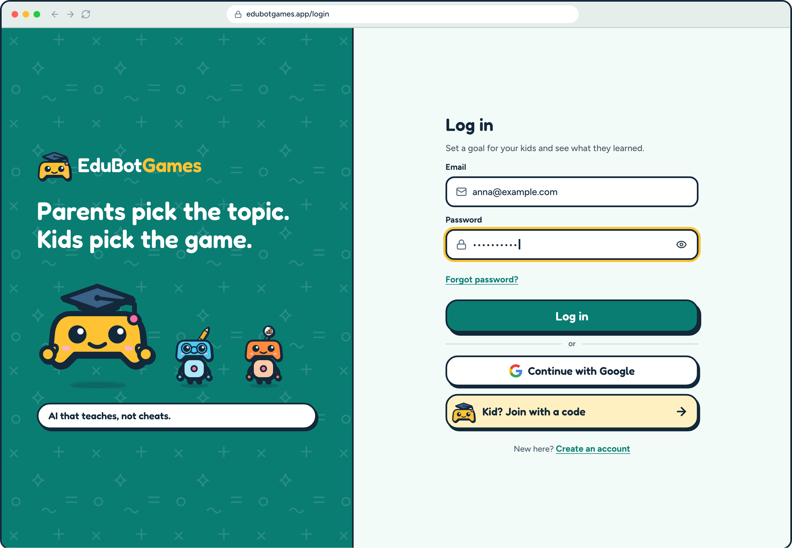 | 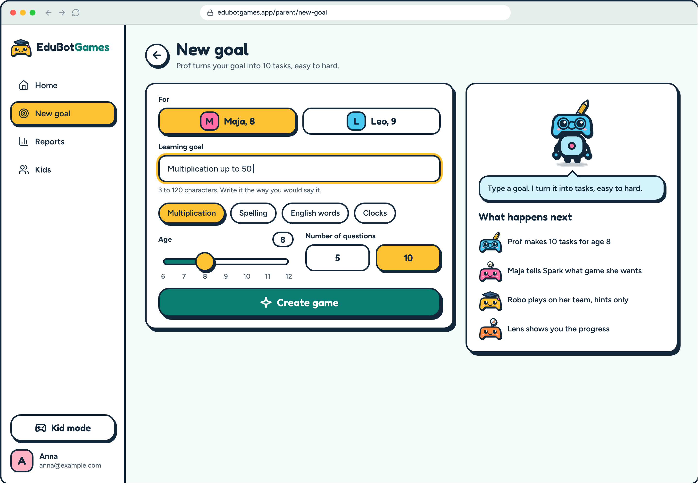 |
| **Log in** | **New goal.** The parent sets topic, age and number of questions. |
| 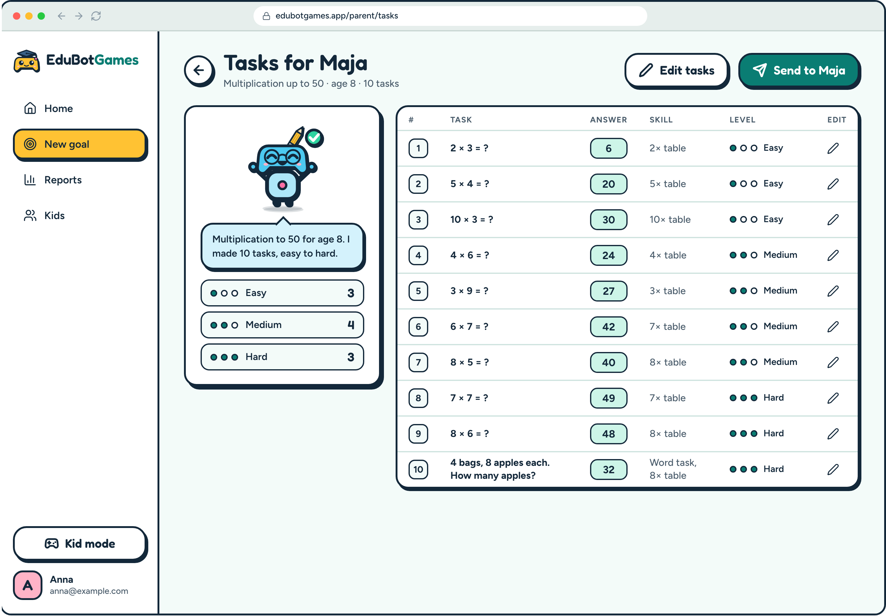 | 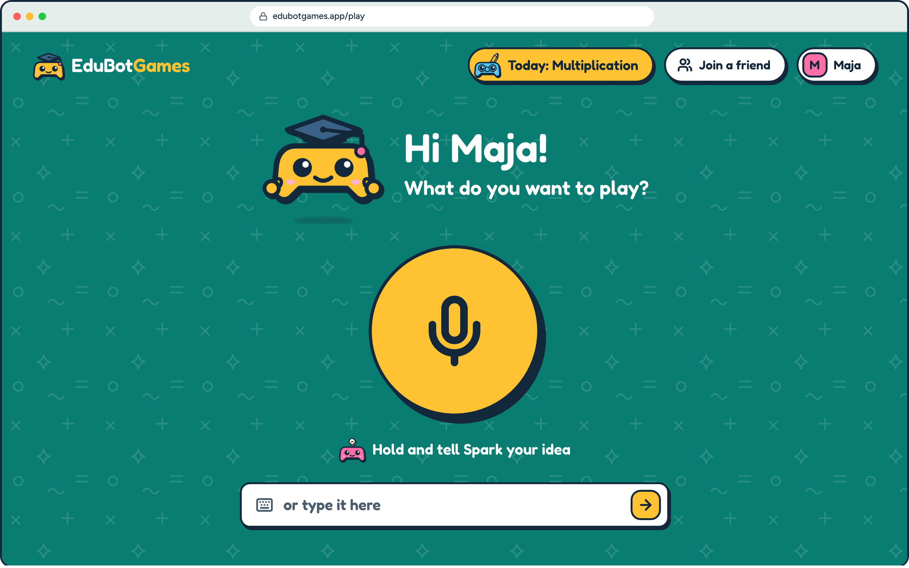 |
| **Prof's preview.** 10 tasks, easy to hard, editable before they go to the kid. | **Kid home** |
| 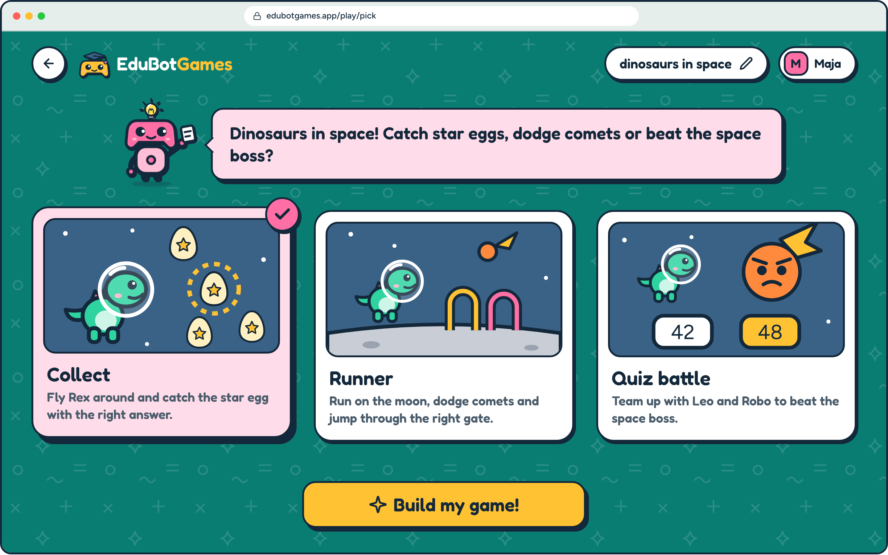 | 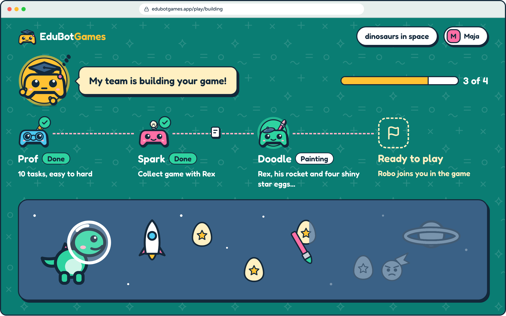 |
| **Pick a game.** Spark offers three game types in the kid's theme. | **Building.** The kid watches the crew hand off. |
| 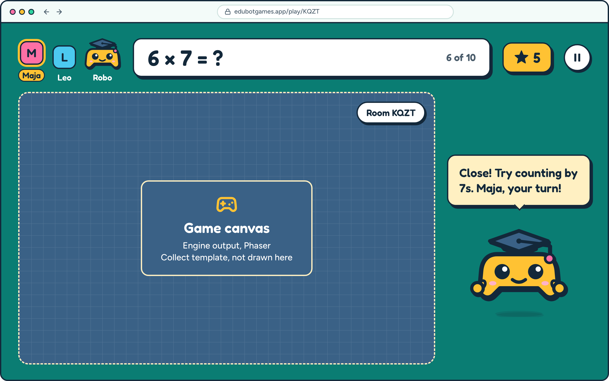 | 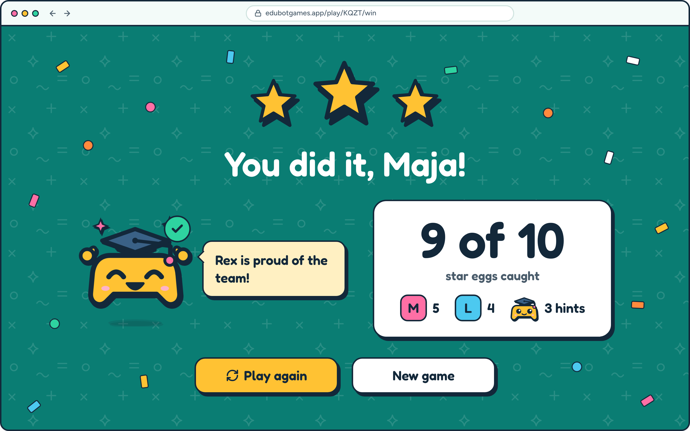 |
| **Game.** The Phaser canvas from the engine, with Robo's hint on the side. | **Win** |
| 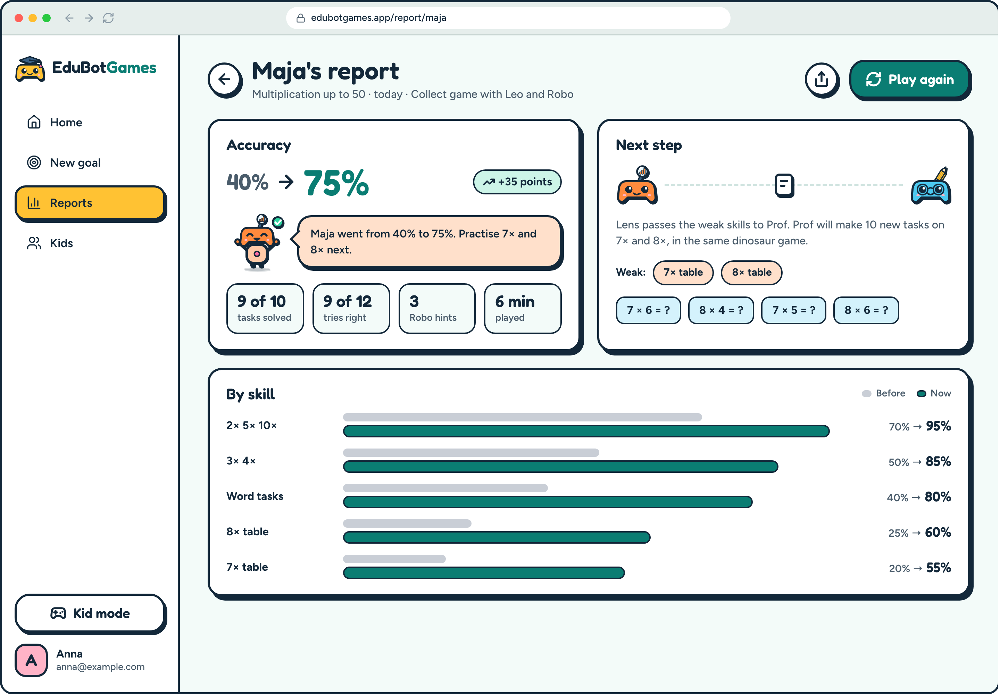 | 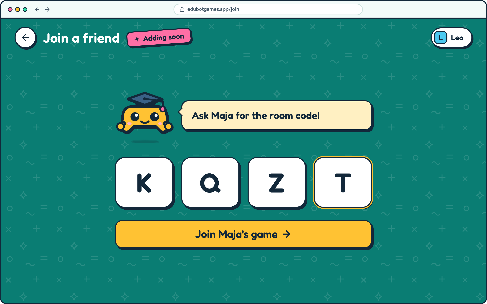 |
| **Lens report.** Before and after, by skill, and the next step. | **Join a friend.** Adding soon, not built yet. |

## Why it wins

| Criterion | How EduBotGames hits it |
|---|---|
| Working prototype | One full path in the demo: parent goal, kid's voice, generated game, parent report. |
| Technical complexity | Five agents pass JSON in a loop (Prof, Spark, Doodle, Robo, Lens, back to Prof) across three Grok APIs: text, Grok Imagine and Grok Voice. |
| Innovation | The kid designs the game by voice. The AI is a player on the kid's side, and it only gives hints. |
| Real-world impact | Robo makes the kid do the thinking. The parent gets a before and after score per skill and one next step. |
| Theme: Multiplayer AI and Multi-agent Systems | Kids, parent and five agents work toward one learning goal. Robo is a player on the kid's team; friends joining by room code is designed and coming next. |

## Demo

The promo video is at the top of [How it works](#how-it-works). The 40% to 75% jump is example data
for the demo. Join a friend appears in the video with an "Adding soon" badge.

## Brand

<p>
  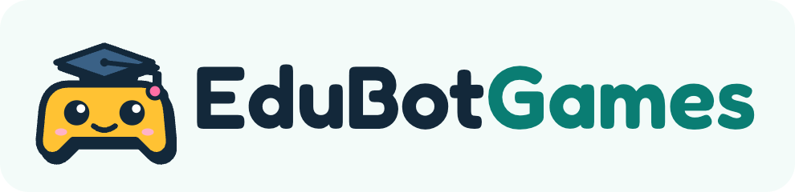
  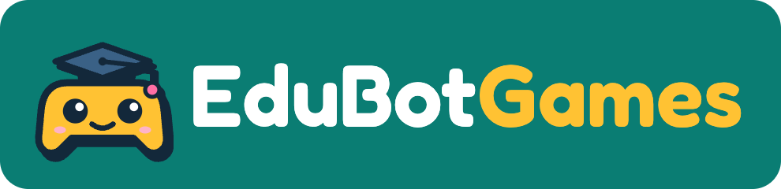
</p>

**[Brand Guidelines 0.1 (PDF)](EduBotGames_Brand_Guidelines_v0.1_2026-11.pdf)** is a 38-page book:
logo, colour, type, characters and the web app flow. The HTML source is
[`brandbook/index.html`](brandbook/index.html); GitHub shows HTML as source, so open it locally or
serve the repo with GitHub Pages and open `/brandbook/`.

### Logo: PadBot

A game controller with a face, wearing a mortarboard. The tassel is the bot's antenna, so game,
school and AI teammate fit in one shape. Keep the face, the cheeks and the tassel-antenna; without
them it turns into a stock pad-and-cap icon.

### Colour: C4 Teal Lagoon

The teal ground points at the school chalkboard.

| Chip | Use |
|---|---|
|  | Brand ground, primary buttons. White text on it (5.01:1). |
|  | Outlines, text, hard shadows. |
|  | PadBot head, chips, stars. Ink text only (9.35:1). |
|  | Highlights. |
|  | Tassel, sparkles, confetti. |
|  | Mortarboard, lighter than ink so its outline stays visible. |
|  | Cheeks, confetti. |
|  | Page background. |

White text goes on teal only. Sun, tangerine and pink never carry white text.

### Type and style

- [Fredoka](https://fonts.google.com/specimen/Fredoka) 600 for the wordmark, headings, buttons and
  kid text (18 px minimum). [Figtree](https://fonts.google.com/specimen/Figtree) for UI and parent
  text.
- Flat fills only, thick ink outlines and a hard offset ink shadow (`5px 6px 0 #13283A`) instead of
  gradients or blur.
- Buttons at least 56 px tall, radius 20 to 28. Motion respects `prefers-reduced-motion`.

### Files

[`brandbook/assets/`](brandbook/assets/) holds the logo, banners, mascot, agents and tokens, each as
SVG and PNG. Design tokens live in
[`tokens.css`](brandbook/assets/tokens/tokens.css) and [`tokens.json`](brandbook/assets/tokens/tokens.json),
and the app uses only these. Logo masters with outlined type are in
[`brandbook/img/logo/`](brandbook/img/logo/). Every brand call, kept or rejected, is in
[`decisions.md`](brandbook/decisions.md).

| Banner | Size | Use |
|---|---|---|
| [`cover-1920x1080`](brandbook/assets/banners/cover-1920x1080.png) | 1920 x 1080 | Pitch title slide, hackathon submission |
| [`vertical-1080x1920`](brandbook/assets/banners/vertical-1080x1920.png) | 1080 x 1920 | Open and end card of the promo video |
| [`readme-1280x640`](brandbook/assets/banners/readme-1280x640.png) | 1280 x 640 | README, GitHub social preview, og:image |
| [`splash-390x844`](brandbook/assets/banners/splash-390x844.png) | 390 x 844 | App splash screen |

## Tech stack

| Layer | Choice |
|---|---|
| App | Next.js web app in the browser |
| Games | Phaser, generated by the game engine from the parent's and the kid's inputs |
| Agents | SpaceXAI (Grok) API, `grok-4.7`, JSON output only |
| Art | Grok Imagine for heroes, backgrounds and items |
| Speech | Grok Voice for the kid's speech, with a text field as fallback |
| Design | Brand tokens from `brandbook/assets/tokens/` |

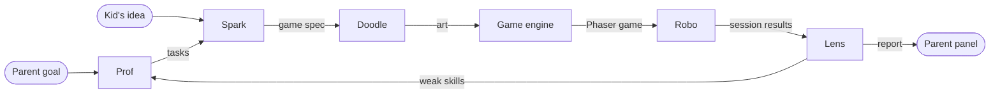

## Project structure

```text
frontend/       source for the screens and the kid/parent agents (copied into backend before build)
backend/        the app you deploy: screens, agents, games API, Phaser host (Next.js)
packages/       shared API contract (zod)
specs/          product spec, agents and prompts, design brief, API, app flow, pitch, video script
brandbook/      Brand Guidelines (index.html), assets, tokens, decisions, build scripts in _src/
design/
  web-book/     the web app screens, desktop 1440 wide (the current product)
  mobile-book/  14 phone screens for a future mobile version
AGENTS.md       notes for coding agents
```

Start with the specs:
[product](specs/01-product-spec.md) ·
[agents](specs/02-agents.md) ·
[design brief](specs/03-design-brief.md) ·
[API](specs/04-api.md) ·
[app flow](specs/05-app-flow.md) ·
[impact measurement](specs/08-impact-measurement.md)

## Getting started

Needs Node 22 or newer. Put secrets in `.env` (see `.env.example`). Never commit that file.

```bash
npm install
./run.sh
```

Open http://127.0.0.1:3001 and log in with the demo account in
[tests/test-accounts.md](tests/test-accounts.md). With no `XAI_API_KEY`, Prof and Spark use a local
lesson and the engine draws a shape game. A live key turns on Grok text, Imagine, and speech.

`./run.sh` installs the workspaces when `node_modules` is missing and copies `.env` to
`backend/.env.local` when that file is missing.

With that server up, this walks health, a generated game, and the screens from login through play:

```bash
SMOKE_BASE_URL=http://127.0.0.1:3001 npm run smoke --workspace @grok-hack/api
```

To work on the screens alone, against the API on port 3001:

```bash
npm run dev:api
npm run dev:web
```

`frontend/.env.local` needs `API_BASE_URL=http://127.0.0.1:3001`. Set `NEXT_PUBLIC_FLOW_MOCK=1`
there to run the screens on demo data without any API calls.

## Deploy

Production is one Vercel project. The GitHub app cannot see this org, so deploy with the CLI.
The upload root is `backend/`. Do not push this branch to `main`, and do not merge it, until you
have tried the preview.

```bash
npm install
npm run sync:web
cd backend
npx vercel link --yes --project grok-hack-wro
npx vercel deploy --prod --yes
```

`npm run build` inside `backend/` vendors `packages/api-contract` and, when `../frontend` is
present, refreshes the UI copy. A backend-only upload uses the copy already in the repo.
`/api/games`, `/api/health`, `/play/{uuid}`, and `/phaser/runtime.js` stay on this app. Kid screens
are `/play`, `/play/pick`, `/play/building`, `/play/game`, and `/play/win`.

Set these in the Vercel project. Do not commit the values.

| Name | Required | Purpose |
| --- | --- | --- |
| `XAI_API_KEY` | for live agents and drawn art | Without it, local lessons and shape art |
| `XAI_MODEL` | no | Default `grok-4.7` |
| `XAI_IMAGE_MODEL` | no | App default `grok-imagine-image-2.0`. Engine default `grok-imagine-image` |
| `XAI_STT_MODEL` | no | Speech. Default `grok-voice-transcribe-2.0` |
| `XAI_REASONING_EFFORT` | no | Engine default `low` |
| `SUPABASE_URL` | for production games | Server only. Do not use a `NEXT_PUBLIC_` prefix |
| `SUPABASE_SERVICE_ROLE_KEY` | with the URL | Bypasses RLS |
| `PUBLIC_BASE_URL` | yes on Vercel | `https://grok-hack-wro.vercel.app`. Used in `gameUrl` |
| `API_BASE_URL` | no | Leave unset here. The app calls the engine in-process |
| `CORS_ORIGINS` | no | Extra browser origins. Same-origin pages do not need it |
| `GAME_STORE` | no | `memory` forces the process-local store |

Apply `supabase/migrations` before the first production game. `GET /api/health` reports
`storage: supabase` when the keys are set.

Rebuild the brand assets:

```bash
python3 brandbook/_src/export.py
python3 brandbook/_src/export_agents.py
python3 brandbook/_src/book_masters.py
uv run --with playwright python brandbook/_src/svg2png.py "$PWD/brandbook/assets"
```

## Team and credits

- Concept: Cezary Dynak (backend, engine) and Bart Szczepanski (frontend, agents)
- Design and brand: Bart Szczepanski
- Built at Grok Bot Hackathon Wroclaw, 5 Nov 2026, on the SpaceXAI (Grok) API
- Fonts: Fredoka and Figtree from Google Fonts
