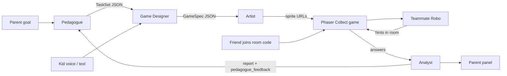

# EduBotGames - deck outline (self-explanatory, no live speaker)

Judges watch a submitted deck + promo video. No live pitch. Every slide must read alone in a few seconds.

Hackathon: Grok Bot Hackathon Wroclaw, Callstack, 5 Nov 2026.
Tracks: **Multi-agent Systems** + **Multiplayer AI**.
One-liner: Kids design a learning game by voice, five Grok agents build it in seconds, AI teammate Robo plays with them, parent sees a before/after delta.

Judging criteria (1-5 each): Working Prototype | Technical Complexity | Innovation | Real-World Impact | Theme Alignment.

Slide count: **8**. Screenshot callouts = record later from the live app (or seed/demo mode). Do not invent UI that is not in 01 / 03 / 05.

---

## Slide 1 - Title + track (must be readable in first 3 s of any deck recording)

**On slide**
- Logo + Robo idle (big)
- Title: **EduBotGames**
- Subtitle: Kids design. Agents build. Robo plays along.
- Track badge (high contrast, top-right or under title):
  `TRACK: Multi-agent Systems  |  Multiplayer AI`
- One-liner under badge (max 2 lines)
- Footer: Grok Bot Hackathon Wroclaw · Callstack · Built with Grok Bots as teammates

**Screenshot / asset:** Robo idle PNG from design export; no app screen required.

**Criteria:** Theme Alignment (track named immediately), Innovation (one-liner).

---

## Slide 2 - Problem

**On slide (3 bullets, short)**
1. Kids use AI to get answers, not to learn.
2. Learning apps are generic. Kids get bored.
3. Parents and teachers have no clear signal that anything improved.

**Bottom strip:** Our flip → AI that teaches, not cheats.

**Screenshot:** optional small S1 Parent setup crop (`/parent`) showing goal chips, so judges see a real product exists. Record later.

**Criteria:** Real-World Impact, Innovation.

---

## Slide 3 - The 5 agents (role · I/O · SpaceXAI)

Self-explanatory table. Judges must see multi-agent without a speaker.

| Agent | Role | Input | Output | SpaceXAI model / tool |
|---|---|---|---|---|
| **Pedagogue** | Turns parent goal into age-fit tasks | Goal, age, optional prior Analyst report | `TaskSet` JSON (10 tasks, distractors, difficulty, skill) | **grok-4.7** via `/v1/responses` + Structured Outputs; tools: `get_last_report`, `save_tasks` |
| **Game Designer** | Weaves kid theme into a Phaser template | Kid prompt (STT or text), TaskSet, templates | `GameSpec` JSON (template, title, theme, sprite prompts, tasks) | **grok-4.7** Responses + Structured Outputs; tools: `list_templates`, `save_game_spec` |
| **Artist** | Draws hero, background, items | GameSpec prompts | Asset URLs | **grok-imagine-image-2.0** via `/v1/images/generations` (wrapped as `generate_image`); `get_cached_asset` |
| **Teammate Robo** | Plays WITH kids; hints, never answers | Current task, wrong answers, player names | Hint/cheer/turn JSON | **grok-4.7** Responses; tools: `get_game_state`, `send_hint`. Optional stretch: TTS / **grok-voice-latest** realtime |
| **Analyst** | Measures progress for parent; feeds Pedagogue | Session answers, times, hints, prior session | Report JSON (delta, skills, weak skills, next step, `pedagogue_feedback`) | **grok-4.7** Responses; tools: `get_session_results`, `save_report`, `notify_pedagogue` |

**Kid voice in:** Grok Voice STT **grok-voice-transcribe-2.0** (`wss://api.x.ai/v1/stt`) → text for Designer. Text field fallback.

**Footer note:** Orchestrator is plain code (not an LLM). It runs the pipeline and emits SSE events to the UI timeline.

**Screenshot:** S2 AgentTimeline chips lit (`/play/[sessionId]` building state). Record later.

**Criteria:** Technical Complexity, Theme Alignment (Multi-agent), Working Prototype (visible handoff).

---

## Slide 4 - Agent handoff diagram

**Caption under diagram:** Pedagogue → Designer → Artist → Ready (shown live on S2). Teammate runs in-game. Analyst closes the loop.

**Screenshot:** full-bleed S2 timeline mid-pipeline next to the mermaid (or replace mermaid with a clean static version of the same graph if mermaid is not rendered in the deck tool).

**Criteria:** Theme Alignment, Technical Complexity, Working Prototype.

---

## Slide 5 - App flow (4 screens + join)

Numbered strip, left to right. Each cell = one real screen.

| # | Screen | Route | What judges should read | Screenshot to place |
|---|---|---|---|---|
| S1 | Parent setup | `/parent` | Pick kid (e.g. Ola, 8), goal "mnożenie do 50", Stwórz grę | Full S1 |
| S2 | Kid prompt + agents | `/play/[sessionId]` | Mic / text "dinozaury w kosmosie", AgentTimeline Pedagogue → Designer → Artist → Ready | S2 building |
| S3 | Game | `/game/[gameId]` | Phaser Collect, Robo hint bubble, score, room code | S3 with hint |
| S3b | Join (stretch) | `/join` | 4-letter code → second player avatar | Join + dual avatars |
| S4 | Parent panel | `/report/[kidId]` | 40% → 75%, skills, next step, Zagraj znowu | S4 DeltaCard |

**Callout:** MVP template = Collect. Runner / Quiz battle = stretch.

**Criteria:** Working Prototype, Theme Alignment (multiplayer join), Innovation (kid designs theme).

---

## Slide 6 - Tech stack / architecture

**Left column - stack**
- Next.js 15 App Router + TypeScript + Tailwind
- Phaser 3 (client-only dynamic import)
- In-memory store (`lib/store.ts`), Zod schemas, SSE for timeline + room
- SpaceXAI global `https://api.x.ai/v1` (server Route Handlers only; key never in client)

**Right column - xAI surface area**
- **grok-4.7** - all 5 agents, Structured Outputs, function tools
- **grok-imagine-image-2.0** - sprites / backgrounds
- **grok-voice-transcribe-2.0** - kid speech → text (MVP)
- Optional stretch: **grok-voice-latest** realtime / TTS for Robo

**Bottom architecture one-liner:**
`Browser → Next.js API → Orchestrator → Agents (JSON) → Phaser GameSpec → SSE timeline / room`

**Screenshot:** optional tiny curl or network panel is NOT needed. Prefer a clean diagram. If a shot is needed, S2 Ready → S3 transition proves the pipeline.

**Criteria:** Technical Complexity (primary), Working Prototype.

---

## Slide 7 - Design system

**On slide**
- Robo mascot: 4 poses - idle, thinking, hint, cheer (flat 2D, round head, screen face, one antenna)
- Palette swatches with hex:
  - Primary purple `#6C4DF6`
  - Sunny yellow `#FFC93C`
  - Mint `#2ED3A0`
  - Coral `#FF6B6B`
  - Ink `#1E1B3A`
  - Cream `#FFF8EC`
- Type: Baloo 2 or Nunito (kid headings), Inter (parent panel)
- UI rules: radius 20-28, touch targets ≥ 56 px, mobile-first 390×844
- Agent chips: colored, icon, glow when active

**Screenshot:** 2×2 collage of S1-S4 (record later), Robo poses from design export.

**Criteria:** Innovation (kid-trustworthy product feel), Theme Alignment (agents visible in UI), Working Prototype (real screens).

---

## Slide 8 - Impact + close

**Top half - Impact**
- Big number: **40% → 75%** (+35 pp) from seeded before session + live after
- Parent gets: accuracy delta, skill bars, weak skills, one next step
- Tagline: **AI that teaches, not cheats** / **AI które uczy, nie ściąga**

**Bottom half - Close**
- Track badge repeated: Multi-agent Systems | Multiplayer AI
- Recap chips: 5 agents · kid voice design · Robo teammate · friends via room code · parent delta
- Built with Grok Bots as our hackathon teammates
- Thank you / EduBotGames

**Screenshot:** S4 DeltaCard full bleed behind the numbers.

**Criteria:** Real-World Impact, Innovation, Theme Alignment.

---

## Criteria coverage map

| Criterion | Slides |
|---|---|
| Working Prototype | 3, 4, 5, 6, 7 |
| Technical Complexity | 3, 4, 6 |
| Innovation | 1, 2, 5, 7, 8 |
| Real-World Impact | 2, 8 |
| Theme Alignment | 1, 3, 4, 5, 7, 8 |

---

## Recording checklist for deck screenshots (later)

1. `/` S0 Landing with Robo (optional support for slide 1)
2. `/parent` S1 with Ola + goal chip
3. `/play/[sessionId]` S2 idle, building (timeline), ready
4. `/game/[gameId]` S3 Collect + Robo hint + room code
5. `/join` S3b (only if multiplayer built)
6. `/report/[kidId]` S4 40% → 75%
7. Robo pose sheet: idle, thinking, hint, cheer

Fallback if API is down while capturing: `/game/demo` + seeded report from `lib/seed.ts`.

---

## Flags (assumptions)

- Multiplayer join is stretch in 05-app-flow.md. Slide 5 marks S3b as stretch; keep the cell but label it. Do not claim it as MVP unless built.
- Robo live voice (TTS / grok-voice-latest) is stretch. Slide 3 lists STT as MVP and live voice as optional.
- Drawing-photo → image understanding is stretch (04-api.md). Not on these slides unless shipped.
- Before score on S4 comes from seeded session (Ola 40%), not a live first run during recording.
- Grok Bot is named as hackathon teammates (team process), not an in-product public API, per 04-api.md.
- Artist model id in deck: **grok-imagine-image-2.0** (from 04-api.md). Product one-liner may say "Grok Imagine"; deck uses the concrete model id for Technical Complexity.
