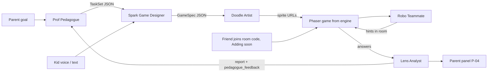

# EduBotGames - deck outline (self-explanatory, no live speaker)

Judges watch a submitted deck + promo video. No live pitch. Every slide must read alone in a few seconds.

Hackathon: Grok Bot Hackathon Wroclaw, Callstack, 5 Nov 2026.
Tracks: **Multi-agent Systems** + **Multiplayer AI**.
Slogan (brandbook): **Parents pick the topic. Kids pick the game.**
One-liner: Kids design a learning game by voice, five Grok agents (Robo, Prof, Spark, Doodle, Lens) build it in seconds, Robo plays on the kid's team with hints, the parent sees a before/after delta.

Brand: follow 09-brand-check.md (C4 Teal Lagoon, Fredoka 600 + Figtree, PadBot logo, sticker style). Product copy is English; demo kid is Maja, 8.

Judging criteria (1-5 each): Working Prototype | Technical Complexity | Innovation | Real-World Impact | Theme Alignment.

Slide count: **8**. Screenshot callouts = record later from the live app (or seed/demo mode). Do not invent UI that is not in 01 / 03 / 05.

---

## Slide 1 - Title + track (must be readable in first 3 s of any deck recording)

**On slide**
- Primary logo (PadBot lockup, `brandbook/assets/logo/lockup-dark`) on teal; Robo is the logo, do not add a second robot
- Title: **EduBotGames**
- Subtitle: Parents pick the topic. Kids pick the game.
- Track badge (high contrast, top-right or under title):
  `TRACK: Multi-agent Systems  |  Multiplayer AI`
- One-liner under badge (max 2 lines)
- Footer: Grok Bot Hackathon Wroclaw · Callstack · Built with Grok Bots as teammates

**Screenshot / asset:** `brandbook/assets/banners/cover-1920x1080.png` as the base; no app screen required.

**Criteria:** Theme Alignment (track named immediately), Innovation (one-liner).

---

## Slide 2 - Problem

**On slide (3 bullets, short)**
1. Kids use AI to get answers, not to learn.
2. Learning apps are generic. Kids get bored.
3. Parents and teachers have no clear signal that anything improved.

**Bottom strip:** Our flip → AI that teaches, not cheats.

**Screenshot:** optional small P-02 New goal crop, so judges see a real product exists. Record later.

**Criteria:** Real-World Impact, Innovation.

---

## Slide 3 - The 5 agents (role · I/O · SpaceXAI)

Self-explanatory table. Judges must see multi-agent without a speaker.

| Agent | Role | Input | Output | SpaceXAI model / tool |
|---|---|---|---|---|
| **Prof** (Pedagogue) | Turns parent goal into age-fit tasks | Goal, age, optional prior Analyst report | `TaskSet` JSON (10 tasks, distractors, difficulty, skill) | **grok-4.7** via `/v1/responses` + Structured Outputs; tools: `get_last_report`, `save_tasks` |
| **Spark** (Game Designer) | Weaves kid theme into a Phaser template | Kid prompt (STT or text), TaskSet, templates | `GameSpec` JSON (template, title, theme, sprite prompts, tasks) | **grok-4.7** Responses + Structured Outputs; tools: `list_templates`, `save_game_spec` |
| **Doodle** (Artist) | Draws hero, background, items | GameSpec prompts | Asset URLs | **grok-imagine-image-2.0** via `/v1/images/generations` (wrapped as `generate_image`); `get_cached_asset` |
| **Robo** (Teammate, lead) | Plays WITH kids; hints, never answers | Current task, wrong answers, player names | Hint/cheer/turn JSON | **grok-4.7** Responses; tools: `get_game_state`, `send_hint`. Optional stretch: TTS / **grok-voice-latest** realtime |
| **Lens** (Analyst) | Measures progress for parent; feeds Pedagogue | Session answers, times, hints, prior session | Report JSON (delta, skills, weak skills, next step, `pedagogue_feedback`) | **grok-4.7** Responses; tools: `get_session_results`, `save_report`, `notify_pedagogue` |

**Kid voice in:** Grok Voice STT **grok-voice-transcribe-2.0** (`wss://api.x.ai/v1/stt`) → text for Spark. Text field fallback.

**Footer note:** Orchestrator is plain code (not an LLM). It runs the pipeline and emits SSE events to the UI timeline.

**Screenshot:** K-04 Building with the crew timeline lit and the xAI call panel. Record later.

**Criteria:** Technical Complexity, Theme Alignment (Multi-agent), Working Prototype (visible handoff).

---

## Slide 4 - Agent handoff diagram

**Caption under diagram:** Prof → Spark → Doodle → Robo ready (shown live on K-04 Building). Robo plays in-game. Lens closes the loop back to Prof.

**Screenshot:** full-bleed K-04 timeline mid-pipeline next to the mermaid (or replace mermaid with a clean static version of the same graph if mermaid is not rendered in the deck tool).

**Criteria:** Theme Alignment, Technical Complexity, Working Prototype.

---

## Slide 5 - App flow (web app screens from design/web-book)

Numbered strip, left to right. Each cell = one real screen (desktop 1440 wide, per brandbook decisions).

| # | Screen | What judges should read | Screenshot to place |
|---|---|---|---|
| P-02 | New goal | Maja, 8, "Multiplication up to 50", 10 questions | `design/web-book/img/p02-new-goal.png` until live capture |
| P-03 | Prof's preview | 10 tasks, easy to hard, editable | `p03-prof-preview.png` |
| K-03 | Pick a game | Spark offers Collect, Runner, Quiz battle for "Dinosaurs in space" | `k03-pick-a-game.png` |
| K-04 | Building | Crew timeline Prof → Spark → Doodle → Robo, plus xAI call panel | `k04-building.png` |
| K-05 | Game | Phaser canvas, players Maja, Leo, Robo, Robo hint bubble | `k05-game.png` |
| K-07 | Join a friend | Room code, "Adding soon" badge | `k07-join.png` |
| P-04 | Lens report | 40% → 75%, per skill bars, next step | `p04-lens-report.png` |

**Callout:** Spark offers 2-3 game types; the game is generated by the engine. Join a friend is "Adding soon".

**Criteria:** Working Prototype, Theme Alignment (multiplayer join), Innovation (kid designs theme).

---

## Slide 6 - Tech stack / architecture

**Left column - stack (real repo, see 10-architecture.md)**
- Next.js 16 API (`backend/`, port 3001) + TypeScript + zod contract package (`packages/api-contract`)
- Supabase Postgres (games, tasks, answers, reports, xai_calls) + Storage bucket `game-assets` + Realtime for the timeline and room
- Phaser game from the teammate's engine, served from Storage
- Web app UI on brand tokens (`brandbook/assets/tokens/`)
- SpaceXAI global `https://api.x.ai/v1` from server routes only; browser voice via ephemeral tokens

**Right column - xAI surface area**
- **grok-4.7** - Prof, Spark, Robo, Lens via `/v1/responses`: Structured Outputs, function tools, `code_execution` (Lens stats), moderation `guidelines`
- **grok-imagine-image-2.0** - Doodle's sprites / backgrounds
- **grok-voice-transcribe-2.0** - kid speech → text (MVP)
- **TTS** `/v1/tts` for Robo hints; stretch **grok-voice-latest** realtime with ephemeral tokens
- Live xAI call panel: model, latency, tokens, cost per call

**Bottom architecture one-liner:**
`Browser → Next.js 16 API → Orchestrator → 5 agents on xAI (JSON) → engine builds Phaser → Supabase Storage + Realtime timeline / room`

**Screenshot:** optional tiny curl or network panel is NOT needed. Prefer a clean diagram. If a shot is needed, K-04 done → K-05 transition proves the pipeline.

**Criteria:** Technical Complexity (primary), Working Prototype.

---

## Slide 7 - Design system (from Brand Guidelines v0.1)

**On slide**
- Robo = the PadBot logo: game controller face, mortarboard, tassel antenna, mitten hands. In-game poses idle, think, hint, cheer (`brandbook/assets/mascot/`)
- The crew with props and colors: Prof `#4CC9F0`, Spark `#FF6FA5`, Doodle `#2ED3A0`, Lens `#FF8A3D`; Robo `#FFC233` bigger and first. States idle, working, handoff, done
- Palette C4 Teal Lagoon with hex:
  - teal `#0A7D73`, ink `#13283A`, sun `#FFC233`, tangerine `#FF8A3D`
  - pink `#FF6FA5`, cap blue `#3A6186`, cheek `#FFB3C7`, cream `#F3FBF9`
- Type: Fredoka 600 (headings, buttons, kid text 18 px+), Figtree (UI, parent text)
- Style: flat fills, 3 px ink line, hard shadow `5px 6px 0 #13283A`, no gradients or blur. Buttons 56 px+, radius 20-28
- Voice: fun older friend for kids, plain numbers for parents

**Screenshot:** a page from the Brand Guidelines PDF (crew 5.2) next to a 2x2 collage of K-03, K-04, K-05, P-04.

**Criteria:** Innovation (kid-trustworthy product feel), Theme Alignment (agents visible in UI), Working Prototype (real screens).

---

## Slide 8 - Impact + close

**Top half - Impact**
- Big number: **40% → 75%** (+35 pp) for Maja, labeled example data, plus the real pilot table from 08-impact-measurement.md if collected
- Parent gets: accuracy delta, skill bars, weak skills, one next step
- Tagline: **AI that teaches, not cheats**

**Bottom half - Close**
- Track badge repeated: Multi-agent Systems | Multiplayer AI
- Recap chips: 5 agents · kid voice design · Robo teammate · friends via room code (Adding soon) · parent delta
- Built with Grok Bots as our hackathon teammates
- Thank you / EduBotGames

**Screenshot:** P-04 Lens report full bleed behind the numbers; end with the primary logo.

**Criteria:** Real-World Impact, Innovation, Theme Alignment.

---

## Criteria coverage map

| Criterion | Slides |
|---|---|
| Working Prototype | 3, 4, 5, 6, 7 |
| Technical Complexity | 3, 4, 6 |
| Innovation | 1, 2, 5, 7, 8 |
| Real-World Impact | 2, 8 |
| Theme Alignment | 1, 3, 4, 5, 7, 8 |

---

## Recording checklist for deck screenshots (later)

1. P-02 New goal with Maja, 8, "Multiplication up to 50"
2. P-03 Prof's preview
3. K-03 Pick a game, K-04 Building (timeline + xAI call panel)
4. K-05 Game with Robo hint
5. K-07 Join a friend ("Adding soon")
6. P-04 Lens report 40% → 75%
7. Robo poses idle, think, hint, cheer from `brandbook/assets/mascot/`

Fallback if API is down while capturing: seeded game and report (see 10-architecture.md fallbacks), or the PNGs in `design/web-book/img/`.

---

## Flags (assumptions)

- Multiplayer join is stretch in 05-app-flow.md. Slide 5 marks S3b as stretch; keep the cell but label it. Do not claim it as MVP unless built.
- Robo live voice (TTS / grok-voice-latest) is stretch. Slide 3 lists STT as MVP and live voice as optional.
- Drawing-photo → image understanding is stretch (04-api.md). Not on these slides unless shipped.
- Before score on P-04 comes from seeded example data (Maja 40%), not a live first run during recording.
- Grok Bot is named as hackathon teammates (team process), not an in-product public API, per 04-api.md.
- Artist model id in deck: **grok-imagine-image-2.0** (from 04-api.md). Product one-liner may say "Grok Imagine"; deck uses the concrete model id for Technical Complexity.
