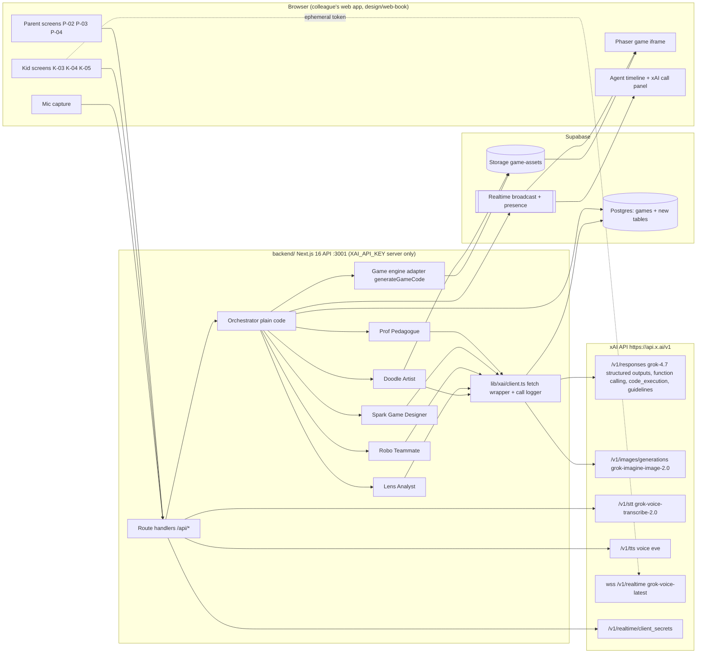

# EduBotGames - architecture (real stack, xAI API at the center)

Written 5 Nov 2026 from the real repo snapshot. Replaces the stack assumptions in 05-app-flow.md and 06 slide 6 (Next.js 15, in-memory `lib/store.ts`, Tailwind). Every xAI parameter below was checked against docs.x.ai pages listed in `xai-llms.txt` (append `.md`). Before coding a call, open that page again. Do not guess parameters.

## 0. Real stack today (what is in the repo)

| Part | What exists | Notes |
|---|---|---|
| Root | npm workspaces `backend`, `packages/*`; Node >= 22 | `npm run dev` starts the API on port 3001 |
| `backend/` (`@grok-hack/api`) | Next.js 16 App Router, API only, React 19, zod 4, `@supabase/supabase-js` 2, `backend/vercel.ts` | Routes: `GET /api/health`, `POST /api/games`, `GET /api/games/:id`. CORS via `CORS_ORIGINS` (`lib/http.ts`). `backend/AGENTS.md`: this Next.js has breaking changes, read `node_modules/next/dist/docs/` before coding. |
| Pipeline | `lib/games/create-game.ts` runs `generateGameCode -> generateGraphics -> storeGameAssets -> deployGame` synchronously, status `queued -> generating -> ready / failed` | TODO in code: move off the request path (Vercel Workflow), respond 202, client polls |
| Repository | `lib/games/repository.ts` with `memory-repository.ts` and `supabase-repository.ts`; `store.ts` picks Supabase when `SUPABASE_URL` and `SUPABASE_SERVICE_ROLE_KEY` are set | Works with no env at all |
| `packages/api-contract` | zod schemas + types: `createGameRequestSchema` (strict: `parentPrompt`, `childPrompt`, `childAge?`, `language?`), `gameSchema`, errors, `apiPaths` | Strict object: new fields need a contract change first. Docs: `docs/api-contract.md`, `docs/openapi.yaml` |
| `supabase/` | Migration `20261105175328_create_games.sql`: table `public.games` (RLS on, no policies, service role only) + public Storage bucket `game-assets` (`{gameId}/index.html`, images, audio mime types allowed). `config.toml`: realtime enabled, storage enabled | No tables yet for tasks, answers, reports, rooms, xAI call log |
| Frontend | Not in this repo. A colleague's web app (Next.js target per AGENTS.md) calls this API. Design to port: `design/web-book/` | Voice is "in the frontend" per api-contract today |
| Game engine | Built by a teammate. Inputs: parent (topic, age, number of questions) and kid (voice idea, chosen game type). Output: Phaser game | In this API the hook is `generateGameCode()` |
| Env (`.env.example`) | `XAI_API_KEY`, `XAI_MODEL` (commented, `grok-4`), `SUPABASE_URL`, `SUPABASE_SERVICE_ROLE_KEY`, `VERCEL_TOKEN`, `VERCEL_TEAM_ID`, `VERCEL_PROJECT_ID`, `CORS_ORIGINS`, `GAME_PUBLIC_URL_BASE`, `GAME_ASSET_BASE_URL`, frontend-only `API_BASE_URL` / `NEXT_PUBLIC_API_BASE_URL` | Root AGENTS.md also mentions `GROK_BOT_API_KEY` in `.env` |

### Where xAI is called today
**Nowhere.** No file in `backend/` or `packages/` calls `api.x.ai`. Status of each xAI touchpoint:

| File | Today | Target xAI call |
|---|---|---|
| `backend/lib/services/generate-game-code.ts` | Stub HTML, comment "TODO: Generate ... with the xAI Grok API" | Spark spec (Responses) + engine; optionally Grok writes Phaser scene code |
| `backend/lib/services/generate-graphics.ts` | Stub SVG, "Do not call an image API from this stub" | Doodle: `POST /v1/images/generations` `grok-imagine-image-2.0` |
| `backend/lib/services/store-assets.ts` | Uploads stub bytes to `game-assets` | Upload real PNG/JPEG from Imagine and TTS audio |
| Prof, Robo, Lens, STT, TTS, realtime token | Missing | New services and routes below |
| `.env.example` `XAI_MODEL=grok-4` | Old default | Set `XAI_MODEL=grok-4.7`, fallback `grok-4.6` (docs models page) |

## 1. Component diagram



## 2. Happy path sequence

```mermaid
sequenceDiagram
  autonumber
  participant Par as Parent (P-02/P-03)
  participant Kid as Kid (K-01..K-05)
  participant API as backend API
  participant X as xAI API
  participant DB as Supabase DB+Storage
  participant RT as Supabase Realtime

  Par->>API: POST /api/goals {topic, age, count, kidName}
  API->>X: Prof: /v1/responses grok-4.7, text.format json_schema TaskSet, guidelines
  X-->>API: TaskSet JSON (10 tasks)
  API->>DB: insert goals, tasks, xai_calls
  API-->>Par: tasks for P-03 preview (editable)

  Kid->>API: POST /api/stt (audio blob)
  API->>X: POST /v1/stt model grok-voice-transcribe-2.0
  X-->>API: transcript "dinosaurs in space"
  API->>X: Spark step 1: /v1/responses grok-4.7 json_schema GameOptions
  X-->>API: 2-3 options (collect, runner, quiz_battle)
  API-->>Kid: K-03 cards

  Kid->>API: POST /api/games {goalId, childPrompt, template}
  API-->>Kid: 202 {gameId}
  API->>RT: broadcast agent_event spark working
  API->>X: Spark step 2: /v1/responses json_schema GameSpec (previous_response_id)
  API->>RT: spark handoff, doodle working
  API->>X: Doodle: /v1/images/generations grok-imagine-image-2.0 (hero, background, items)
  API->>DB: upload PNGs to game-assets/{gameId}/
  API->>API: engine builds Phaser bundle from GameSpec + asset URLs
  API->>DB: upload index.html, games.status=ready
  API->>RT: doodle done, robo ready
  Kid->>DB: load Phaser game from Storage URL

  loop each task (phase pre, play, post)
    Kid->>API: POST /api/games/:id/answers {taskId, answer, ms, phase}
    alt wrong answer in play phase
      API->>X: Robo: /v1/responses grok-4.7 json_schema Hint, guidelines
      X-->>API: {type: hint, text, next_player}
      API->>X: optional POST /v1/tts voice eve (hint audio)
      API->>RT: broadcast robo_hint to room
    else correct
      API->>RT: broadcast cheer + score
    end
  end

  Kid->>API: POST /api/games/:id/finish
  API->>X: Lens: /v1/responses grok-4.7 tools code_execution + json_schema Report
  X-->>API: report (accuracy pre/post, gain g, by_skill, weak_skills, next step)
  API->>DB: insert reports
  API-->>Par: P-04 Lens report
  API->>X: Prof next round uses report.pedagogue_feedback
```

## 3. Agents and their exact xAI calls

All text agents: `POST https://api.x.ai/v1/responses`, `Authorization: Bearer $XAI_API_KEY`, model `process.env.XAI_MODEL ?? "grok-4.7"` (fallback `grok-4.6`, same price per docs pricing page). Structured outputs on the Responses API use `text: { format: { type: "json_schema", name, schema, strict: true } }` (docs: model-capabilities/text/structured-outputs). Kid safety: add `guidelines: [{type:"policy",category:"nsfw",behavior:"decline"},{type:"policy",category:"violence",behavior:"decline"},{type:"policy",category:"profanity",behavior:"decline"}]` (docs: advanced-api-usage/custom-moderation-controls; only behavior today is `decline`). Treat parent and kid text as untrusted data inside the prompt.

| Agent (agents.json key) | Trigger / route | xAI endpoint and model | Features used | Output schema | Est. cost |
|---|---|---|---|---|---|
| Prof, Pedagogue (`prof`) | `POST /api/goals`, and again after Lens | `/v1/responses` grok-4.7 | json_schema `TaskSet`; function tools `get_last_report(kid_id)` (reads `reports`), `save_tasks(tasks)`; guidelines | TaskSet (02-agents.md 1) | ~$0.015 |
| Spark, Game Designer (`spark`) step 1 | `POST /api/games/options` | `/v1/responses` grok-4.7 | json_schema `GameOptions`; guidelines on the kid's idea | `{options:[{template,title,pitch}]}` | ~$0.005 |
| Spark step 2 | inside `POST /api/games` pipeline | `/v1/responses` grok-4.7, `previous_response_id` from step 1 | json_schema `GameSpec`; function tool `list_templates()` | GameSpec (02-agents.md 2) | ~$0.02 |
| Doodle, Artist (`doodle`) | pipeline, replaces `generateGraphics()` | `POST /v1/images/generations` model `grok-imagine-image-2.0` (docs: model-capabilities/images/generation) | hero + background + 4 items, max 6 images, brand-style prompt prefix; cache by theme in Storage; optional image editing with the hero as reference for consistency (docs: images/editing) | asset URLs in `games.assets` | 6 x $0.04 = $0.24 |
| Game engine (teammate) | pipeline, `generateGameCode()` | none required (template engine). Optional: `/v1/responses` grok-4.7 writes the scene config/code from GameSpec | if code-gen is used: json_schema with `{files:[{path,body}]}` | `index.html` bundle in Storage | $0 to ~$0.10 |
| Robo, Teammate (`robo`) | `POST /api/games/:id/hint` on a wrong answer | `/v1/responses` grok-4.7 | json_schema `Hint`; function tools `get_game_state(room)`, `send_hint(text,next_player)`; guidelines | `{type,text,next_player}` | ~$0.003 per hint |
| Robo voice (read hint aloud) | `POST /api/tts` | `POST https://api.x.ai/v1/tts` `{text, voice_id:"eve", language}` (docs: audio/text-to-speech) | audio cached in Storage `{gameId}/audio/` | mp3 URL | $15 / 1M chars, ~$0.01 per game |
| Robo live voice (stretch) | browser, after `POST /api/realtime/token` | `wss://api.x.ai/v1/realtime?model=grok-voice-latest`, auth with ephemeral token from `POST /v1/realtime/client_secrets` `{expires_after:{seconds:300}}` (docs: audio/ephemeral-tokens, audio/speech-to-speech) | `session.update` with Robo instructions, server VAD, function tools `send_hint`, `get_game_state` | audio | $0.08 / min |
| Kid voice in | `POST /api/stt` (server proxy) | `POST https://api.x.ai/v1/stt` multipart `model=grok-voice-transcribe-2.0`, file (docs: audio/speech-to-text). Streaming alt: `wss://api.x.ai/v1/stt?model=grok-voice-transcribe-2.0&sample_rate=16000&encoding=pcm&interim_results=true` | text fallback field always on | transcript | $0.10/h REST |
| Lens, Analyst (`lens`) | `POST /api/games/:id/finish` | `/v1/responses` grok-4.7 | built-in tool `{type:"code_execution"}` (docs: tools/code-execution) computes accuracy pre/post, Hake gain g, median ms, hint trend, Cohen d when control exists (08-impact-measurement.md); function tools `get_session_results(game_id)`, `save_report(report)`, `notify_pedagogue(feedback)`; final json_schema `Report` | Report + `pedagogue_feedback` | ~$0.02 + $0.005 tool |

Rules for every agent call:
- Deterministic stats are also computed in TS (`lib/analytics/metrics.ts`) and compared with Lens's code_execution result; the UI shows the TS numbers if they differ. Never show LLM-only math to parents.
- If an image call hits a policy decline, retry once with a safer prompt, then use fallback art.
- Responses keeps context server side for `previous_response_id` (04-api.md: stored 30 days), used for the Spark step 1 -> step 2 chain.

Verify before demo: `curl -s https://api.x.ai/v1/models -H "Authorization: Bearer $XAI_API_KEY"` lists grok-4.7, grok-imagine-image-2.0 and the voice models.

## 4. Keys and security
- `XAI_API_KEY` lives only in `backend/.env.local` (local) and Vercel project env (deploy). Never `NEXT_PUBLIC_`. Never returned in any response or log.
- Browser never calls api.x.ai with the key. STT and TTS are proxied through our routes. Realtime voice uses an ephemeral client secret (300 s) minted by `POST /api/realtime/token`; the browser connects with subprotocol `xai-client-secret.<TOKEN>` per docs.
- `SUPABASE_SERVICE_ROLE_KEY` stays server only (already documented in supabase/README.md). Browser Realtime needs a new public pair: `NEXT_PUBLIC_SUPABASE_URL`, `NEXT_PUBLIC_SUPABASE_ANON_KEY` (add to `.env.example`, no secret). Use Broadcast + Presence channels only; tables stay RLS-closed.
- Rate limit hint, STT and token routes per game id (simple in-memory counter) so a kid cannot burn credits.

## 5. Supabase tables

Existing: `public.games` (keep). Add one migration `supabase/migrations/<timestamp>_learning_loop.sql`, same pattern (RLS on, revoke anon/authenticated, grant service_role):

| Table | Columns (key ones) | Why |
|---|---|---|
| `goals` | id, kid_name, child_age, topic, question_count, language, previous_report_id null, created_at | P-02 input, Prof input |
| `tasks` | id, goal_id, idx, question, answer, distractors jsonb, difficulty 1-3, skill, form 'A'/'B' null, phase 'pre'/'play'/'post' | Prof output, editable in P-03 |
| `games` (alter) | add goal_id uuid null, template text null, spec jsonb null, room_code text unique null, condition 'game'/'control' default 'game' | link game to goal; Spark spec; room; 08 control |
| `players` | id, game_id, name, is_ai bool, joined_at | multiplayer avatars (Maja, Leo, Robo) |
| `answers` | id, game_id, task_id, player_id, phase 'pre'/'play'/'post'/'retention', form, answer, correct bool, ms int, hints_used int, created_at | 08-impact-measurement event log |
| `hints` | id, game_id, task_id, attempt, type 'hint'/'cheer'/'turn', text, next_player, audio_url null | Robo log, hint fade curve |
| `reports` | id, game_id, goal_id, accuracy_pre, accuracy_post, gain_g, median_ms_pre, median_ms_post, hint_trend jsonb, cohen_d null, n, by_skill jsonb, weak_skills jsonb, parent_summary, pedagogue_feedback, created_at | Lens output, P-04 |
| `xai_calls` | id, game_id null, goal_id null, agent 'prof'/'spark'/'doodle'/'robo'/'lens'/'voice', endpoint, model, status, latency_ms, input_tokens, output_tokens, reasoning_tokens, cached_tokens, images int, audio_seconds numeric, cost_usd numeric, xai_response_id, error, created_at | visible API usage panel and budget |

Contract: add zod schemas for each new request/response in `packages/api-contract/src/schemas.ts` first, then routes. Keep `createGameRequestSchema` backward compatible: add optional `goalId`, `template`.

## 6. Realtime and multiplayer
- `config.toml` has `[realtime] enabled = true`, so use Supabase Realtime.
- Channel `game:{gameId}`: server broadcasts `agent_event` `{agent, state: idle|working|handoff|done, message, xaiCall?}`, `robo_hint`, `score`, `turn`. Presence lists players.
- Server broadcasts with the service role client (`channel.send({type:'broadcast', ...})`); the browser subscribes with the anon key. Server stays source of truth for score and current task.
- Join a friend: `room_code` 4 letters on `games`; `POST /api/rooms/:code/join` inserts a `players` row and returns gameId. Designed as "Adding soon"; build only after the core path works.
- Fallback when Realtime is not configured: `GET /api/games/:id/events` SSE stream from the API (polls `xai_calls` + `games.status` every 500 ms), or plain polling of `GET /api/games/:id` (already exists).

## 7. Visible API usage (for judges)
- Every xAI request goes through `backend/lib/xai/client.ts` (`xaiFetch(agent, endpoint, body)`), which times the call, reads `usage` from the response, computes `cost_usd` from the docs pricing table, inserts an `xai_calls` row and broadcasts it as part of `agent_event`.
- UI (K-04 Building and a collapsible panel on P-04): a timeline row per call: agent head icon, endpoint (`/v1/responses`), model (`grok-4.7`), feature badges (`json_schema`, `function_call x2`, `code_execution`, `guidelines`), latency ms, tokens in/out, cost `$0.004`. Footer: total calls, total cost of this game, "$60 budget: N games left".
- `GET /api/games/:id/xai-calls` returns the list (and `GET /api/usage` totals) so the panel also works after reload.
- Pricing constants (docs pricing page, 5 Nov 2026): grok-4.7 $2.00 in / $0.50 cached / $6.00 out per 1M (< 200k prompt); grok-imagine-image-2.0 $0.04 per image; STT $0.10/h REST, $0.20/h streaming; TTS $15 per 1M chars; realtime $0.08/min; code_execution $5 per 1k calls.

## 8. Cost budget per session vs $60

| Step | Calls | Est. |
|---|---|---|
| Prof | 1 to 2 | $0.015 |
| Spark options + spec | 2 | $0.025 |
| Doodle | 6 images | $0.24 |
| Engine code-gen (optional) | 1 | $0.10 |
| Robo hints | ~8 | $0.025 |
| TTS hints | ~800 chars | $0.012 |
| STT | ~30 s | < $0.01 |
| Lens + code_execution | 1 to 2 | $0.03 |
| **Total per game** | ~20 | **~$0.35 to $0.45** (up to ~$0.80 with 3 min realtime voice) |

$60 covers about 75 to 150 games. Rules: cache images by normalized theme (reuse 2 pre-generated demo themes), cap 6 images per game, cap hints at 2 per task, stop new games when `sum(xai_calls.cost_usd) > $50`. Reasoning tokens are billed as output; log them.

## 9. Fallbacks
| Failure | Fallback |
|---|---|
| No `XAI_API_KEY` or xAI down | Seeded TaskSet, GameSpec and report for "Multiplication up to 50" + "Dinosaurs in space"; timeline still animates, call panel shows "seed" |
| Structured output parse error | One retry with the error message, then seed |
| Image decline or timeout (> 20 s) | Cached theme art, else brand placeholder sprites |
| STT fails | Text field (always visible) |
| Realtime voice fails | TTS of the hint text, else bubble only |
| Supabase not set | Existing memory repository + SSE/polling |
| Lens code_execution fails | TS metrics only, Lens writes summary from them |

## 10. Build order for the remaining ~1 h (priority first)
1. (10 min) `backend/lib/xai/client.ts`: fetch wrapper for `/v1/responses` and `/v1/images/generations`, json_schema helper, guidelines, cost + latency logging to memory and `xai_calls`. Set `XAI_MODEL=grok-4.7` in `.env.example`.
2. (10 min) Prof + Spark services with zod schemas from 02-agents.md; routes `POST /api/goals`, `POST /api/games/options`; extend `POST /api/games` with optional `goalId`, `template`, run Spark step 2 in the pipeline.
3. (10 min) Doodle: replace `generateGraphics()` with Imagine calls (max 6), upload to `game-assets`, theme cache. Feed asset URLs into the engine adapter in `generateGameCode()`.
4. (10 min) Robo hint route + answers route with `phase`; Lens finish route with `code_execution` + TS metrics; migration for `answers`, `reports`, `xai_calls` (others can be jsonb on `games` if short on time).
5. (5 min) `POST /api/stt` proxy; agent events over SSE or Realtime; `GET /api/games/:id/xai-calls`.
6. (5 min) Frontend: K-04 timeline with agent states + call panel; P-04 report.
7. (stretch) TTS for Robo, ephemeral token + realtime Robo, room join, image editing for hero consistency.
Record the demo with the call panel visible.

## 11. Open questions to confirm
- Exact engine API from the teammate (function or HTTP); this spec assumes `generateGameCode(spec, assetUrls)`.
- Whether the frontend app talks to Supabase directly (needs anon key) or only via this API (then use SSE).
- Image API content filtering for kids: not described on the pages read; rely on prompt prefix + guidelines on the text agents, and say only that in the pitch.
